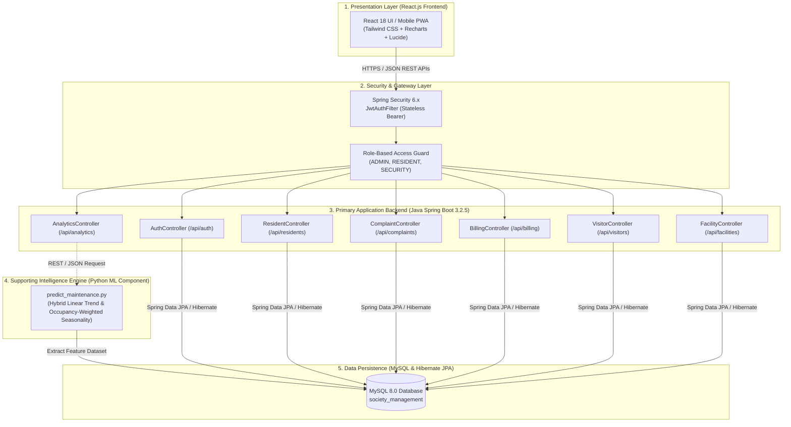
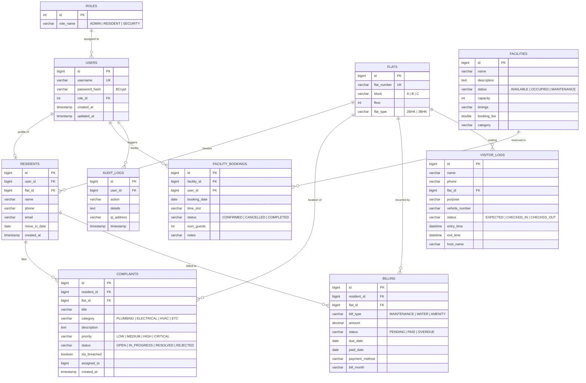

# CODESPARK HACKATHON 2026 — OFFICIAL PROJECT SUBMISSION
## Department of Computer Science & Engineering | KL University — Bachupally Campus
### In Association with Yellowspot Technologies

---

## 📌 Problem Statement Details
* **Track:** TRACK 6 — SMART COMMUNITY & RESIDENTIAL
* **Problem Code:** **AT-37: Smart Apartment Management System**
* **Project Name:** **Resident360 — Smart Community & Apartment Management Platform**
* **Team Size:** 4 Members
* **Duration:** 8-Hour Intensive Engineering Sprint

### Problem Statement Objectives:
> *"Build a platform for managing residents, apartments, maintenance requests, and community services.*  
> *Core functionality: Residents, Apartments, Maintenance, Service requests, Payments.*  
> *Suggested Python component: Predict maintenance demand."*

---

## 🛠️ Technology Stack Compliance Matrix

| Requirement Area | Expected by Hackathon | Implemented in Project | Verification / Proof |
|---|---|---|---|
| **Frontend** | React.js or Angular | **React 18 + Vite + Tailwind CSS + PWA** | Fully responsive, Mobile PWA + Desktop, interactive charts |
| **Primary Backend** | Java with Spring Boot, Spring MVC / REST APIs | **Java 17/25 + Spring Boot 3.2.5** | `society-management-backend` (Maven, Spring Boot Starter Web) |
| **Persistence / ORM** | MySQL/PostgreSQL using Spring Data JPA / Hibernate | **MySQL 8.0 + Spring Data JPA / Hibernate** | 10 Relational entities with cascading, FK constraints & indexes |
| **Security & Auth** | Spring Security / Role-Based Access Control | **Spring Security 6 + JWT + BCrypt** | Stateless JWT tokens with `ROLE_ADMIN`, `ROLE_RESIDENT`, `ROLE_SECURITY` |
| **Supporting Python Component** | AI/ML, prediction, analytics, recommendation | **Python Predictive Regression Engine** | `predict_maintenance.py` trained on ticket frequency, density & seasonality |

---

## 🏗️ System Architecture Diagram



---

## 🗄️ Database Entity-Relationship (ER) Diagram



---

## 🔌 Complete REST API Endpoints Catalog

### 1. Authentication & Identity (`/api/auth`)
* `POST /api/auth/login` — Authenticate user via BCrypt verification & issue JWT token.
* `GET /api/auth/profile` — Retrieve logged-in resident or administrator profile & role.
* `GET /api/auth/health` — Spring Boot security sub-system health check.

### 2. Apartment & Resident Management (`/api/residents`)
* `GET /api/residents` — Fetch all society residents linked to flats and blocks.
* `GET /api/residents/flats` — List all apartment units with occupancy status.
* `GET /api/residents/flat/{flatNumber}` — Retrieve residents by flat number.
* `GET /api/residents/block/{block}` — Retrieve residents by block (Block A, B, C).
* `GET /api/residents/me` — Retrieve resident profile details of the authenticated caller.

### 3. Maintenance & Service Requests (`/api/complaints`)
* `GET /api/complaints` — Retrieve maintenance requests (Admin gets all with priority sorting; Resident gets personal tickets).
* `POST /api/complaints` — File a new maintenance ticket (Title, Category, Priority, Description).
* `PATCH /api/complaints/{id}` — Admin resolution pipeline: update status (IN_PROGRESS, RESOLVED, REJECTED) and assign technicians.

### 4. Billing & Maintenance Payments (`/api/billing`)
* `GET /api/billing` — Retrieve bills (Admin sees global ledger; Resident sees unit invoices).
* `PATCH /api/billing/{id}/pay` — Process digital maintenance payment & update invoice state to `PAID`.
* `GET /api/billing/summary` — Aggregate financial health: total collected, pending dues, collection rate.

### 5. Smart Visitor Management (`/api/visitors`)
* `GET /api/visitors` — Real-time visitor register log.
* `POST /api/visitors` — Pre-authorize expected visitor with destination flat & vehicle number.
* `POST /api/visitors/{id}/checkin` — Guard check-in timestamping.
* `POST /api/visitors/{id}/checkout` — Departure logging & duration calculation.
* `GET /api/visitors/stats` — Real-time active visitor counts on premises.

### 6. Facility & Amenity Booking (`/api/facilities`)
* `GET /api/facilities` — List community amenities (Swimming Pool, Tennis Court, Gym, Clubhouse).
* `GET /api/facilities/bookings` — Slot reservation status (Role-filtered).
* `POST /api/facilities/bookings` — Book time slot with conflict collision detection.
* `PATCH /api/facilities/bookings/{id}/cancel` — Cancel slot booking.

### 7. Supporting Python AI/ML Intelligence (`/api/ai` & `/api/analytics`)
* `GET /api/ai/predict-maintenance` — **Core Problem 37 Deliverable:** Runs Hybrid Linear Trend & Occupancy-Weighted Seasonality Regression to forecast:
  * 30-Day ticket volume projection.
  * 4-Week forward trend with confidence intervals.
  * Category load surge forecast (Plumbing, Electrical, HVAC, etc.).
  * Block vulnerability & risk index (Block A, B, C).
  * Preventive technician workforce staffing recommendations.

---

## 🚀 How to Run the Hackathon Stack

### Prerequisites:
1. **Java JDK 17+ or 25** (`java -version`)
2. **Maven 3.9+** (Included in `C:\Users\HP\Downloads\apache-maven-3.9.6`)
3. **MySQL Server** running on `localhost:3306` with database `society_management`
4. **Node.js 18+** (`node -v`)
5. **Python 3.10+** with `mysql-connector-python`

### 1-Click Launch:
Run the provided batch file:
```cmd
start-hackathon-stack.bat
```

### Manual Individual Commands:
1. **Start Java Spring Boot Backend (Port 8080):**
   ```cmd
   cd society-management-backend
   C:\Users\HP\Downloads\apache-maven-3.9.6\bin\mvn.cmd spring-boot:run
   ```
2. **Start Python AI Maintenance Predictor & Gateway (Port 8000):**
   ```cmd
   cd society-management-platform\api-gateway
   .\venv\Scripts\python.exe -m uvicorn main:app --reload --port 8000
   ```
3. **Start React.js Frontend (Port 5173):**
   ```cmd
   cd society-management-platform\frontend
   npm run dev -- --host
   ```

### Demo Accounts for Evaluators:
* **Administrator:** `admin1` / `password123`
* **Resident (Flat A101):** `resident_a101` / `password123`
